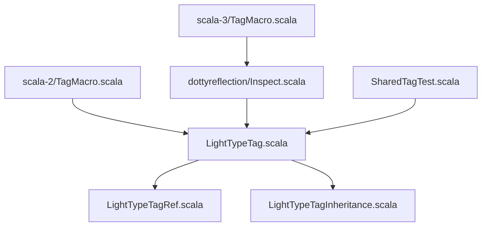

# zio/izumi-reflect

> Lightweight, fast replacement for TypeTag for Scala 2, Scala 3, Scala.js and Native.

## The problem
`scala-reflect` and `TypeTag` have an uncertain future in Scala 3 and compile slowly.

## What it actually does
Scala 2 and 3 macros build a lightweight model of the type system (LightTypeTag). It is used for runtime equality and subtyping checks, and handles unapplied type constructors. It is immutable and thread-safe. The model is not 100% exact (existential types, bounded recursive types).

## How it is wired
Diagram based on the code diagram.



## Trying it
```bash
./sbtgen.sc
./sbtgen.sc --js --native
sbt +test
```

## Cost and gotchas
No cost. The sbt toolchain and a JDK are needed (not in the prerequisites list). `build.sbt` is generated by sbtgen. The license is not identified by GitHub.

## What it is not
Not a faithful replacement for `scala-reflect`: fields, methods and code trees are not preserved. Known limits on existential and path-dependent types.

## Alternatives
- `gzoller/scala-reflection`: preserves fields, but Scala 3 only and without subtyping.
- `airframe-surface`: preserves fields, but without subtyping.

## For you
Ignore: Scala library for JVM framework developers, unrelated to a mainstream data / AI / MLOps profile.
