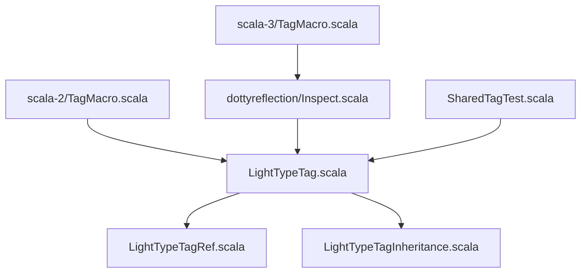

# zio/izumi-reflect

> Remplaçant léger et rapide de TypeTag pour Scala 2, Scala 3, Scala.js et Native.

## Le problème
`scala-reflect` et `TypeTag` ont un avenir incertain en Scala 3 et compilent lentement.

## Ce que ça fait vraiment
Des macros Scala 2 et 3 construisent un modèle léger du système de types (LightTypeTag). Il sert aux vérifications d'égalité et de sous-typage à l'exécution, et gère les constructeurs de types non appliqués. Il est immuable et thread-safe. Le modèle n'est pas exact à 100 % (types existentiels, types récursifs bornés).

## Comment c'est branché
Schéma d'après le diagramme du code.



## Essayer
```bash
./sbtgen.sc
./sbtgen.sc --js --native
sbt +test
```

## Coût et pièges
Aucun coût. Toolchain sbt et JDK nécessaire (pas dans la liste des prérequis). `build.sbt` est généré par sbtgen. La licence n'est pas identifiée par GitHub.

## Ce que ce n'est pas
Pas un remplaçant fidèle de `scala-reflect` : champs, méthodes et arbres de code ne sont pas conservés. Limites connues sur les types existentiels et dépendants de chemin.

## Alternatives
- `gzoller/scala-reflection` : conserve les champs, mais Scala 3 seulement et sans sous-typage.
- `airframe-surface` : conserve les champs, mais sans sous-typage.

## Pour toi
Ignorer : bibliothèque Scala pour développeurs de frameworks JVM, sans lien avec un profil data / IA / MLOps courant.

