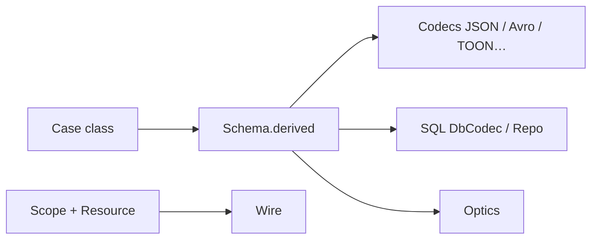

# zio/zio-blocks

> Family of modular Scala libraries, with no imposed effect system: schemas, resources, HTTP, SQL, telemetry.

## The problem
Scala libraries often impose an effect system (ZIO, Cats Effect); independent building blocks are wanted.

## What it actually does
Separate `dev.zio` artifacts. `Schema` derives codecs (built-in JSON, Avro, BSON, CSV, MessagePack, Thrift, TOON, XML, YAML), optics and validators from a single type. `Scope` prevents a resource from escaping at compile time. Also included are `Async`, HTTP, JWT, config, SQL (JDBC), streams, telemetry. Scala 2.13 and 3, JVM and Scala.js.

## How it is wired


## Trying it
```bash
sbt generateReadme
cd async-examples && sbt run
```
Dependency: `libraryDependencies += "dev.zio" %% "zio-blocks-schema" % "0.0.56"` in `build.sbt`.

## Cost and gotchas
Free; version 0.0.56, the API may change. Scala 3.9 and above requires `zio-blocks-next-schema` and `-experimental`.

## What it is not
Not an all-in-one framework: each block is independent. Not for Python. The TOON format aims at more compact LLM prompts than JSON, but it is a side feature.

## Alternatives
The README cites circe, zio-json, jsoniter-scala, cats-effect Resource, macwire, fs2 and Ox as migration starting points.

## For you
Ignore unless your stack is Scala: nothing here for Python, and version 0.0.x remains unstable.
