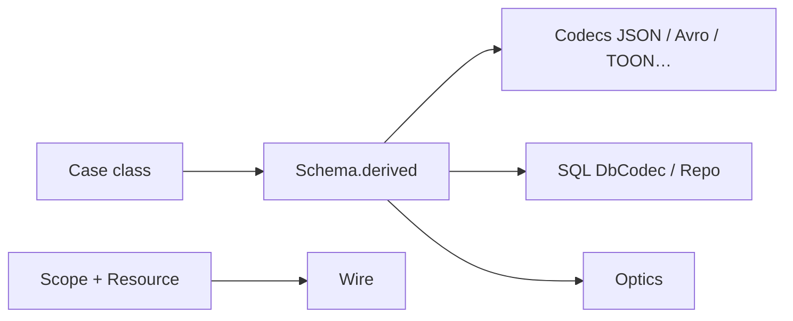

# zio/zio-blocks

> Famille de bibliothèques Scala modulaires, sans système d'effets imposé : schémas, ressources, HTTP, SQL, télémétrie.

## Le problème
Les bibliothèques Scala imposent souvent un système d'effets (ZIO, Cats Effect) ; on veut des briques indépendantes.

## Ce que ça fait vraiment
Des artefacts `dev.zio` séparés. `Schema` dérive codecs (JSON intégré, Avro, BSON, CSV, MessagePack, Thrift, TOON, XML, YAML), optiques et validateurs depuis un seul type. `Scope` empêche à la compilation une ressource de s'échapper. S'y ajoutent `Async`, HTTP, JWT, config, SQL (JDBC), flux, télémétrie. Scala 2.13 et 3, JVM et Scala.js.

## Comment c'est branché


## Essayer
```bash
sbt generateReadme
cd async-examples && sbt run
```
Dépendance : `libraryDependencies += "dev.zio" %% "zio-blocks-schema" % "0.0.56"` dans `build.sbt`.

## Coût et pièges
Gratuit ; version 0.0.56, API susceptible de bouger. Scala 3.9 et plus demande `zio-blocks-next-schema` et `-experimental`.

## Ce que ce n'est pas
Pas un framework tout-en-un : chaque brique est indépendante. Pas pour Python. Le format TOON vise des prompts LLM plus compacts que JSON, mais c'est un à-côté.

## Alternatives
Le README cite circe, zio-json, jsoniter-scala, cats-effect Resource, macwire, fs2 et Ox comme points de départ de migration.

## Pour toi
À ignorer sauf si ta pile est en Scala : rien ici pour Python, et la version 0.0.x reste instable.

