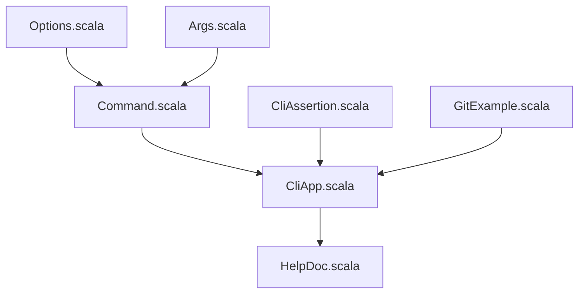

# zio/zio-cli

> Scala library for building command-line applications on ZIO.

## The problem
Hand-writing argument parsing, help and validation for a CLI is tedious.

## What it actually does
You combine `Options` and `Args` in a `Command`, passed to `CliApp.make`, which produces help, validation and execution. Subcommands are supported. Dedicated files adapt the core to the JVM, JS and Native. A testkit makes it possible to test CLIs.

## How it is wired
Diagram based on the code.



## Trying it
```bash
# build.sbt :
# libraryDependencies += "dev.zio" %% "zio-cli" % "0.8.2"
```

## Cost and gotchas
Free. Scala, sbt and the ZIO ecosystem are required.

## What it is not
Not a ready-to-use CLI tool: a library for writing them in Scala.

## Alternatives
None mentioned in the README.

## For you
Ignore: only useful if you write CLIs in Scala/ZIO.
