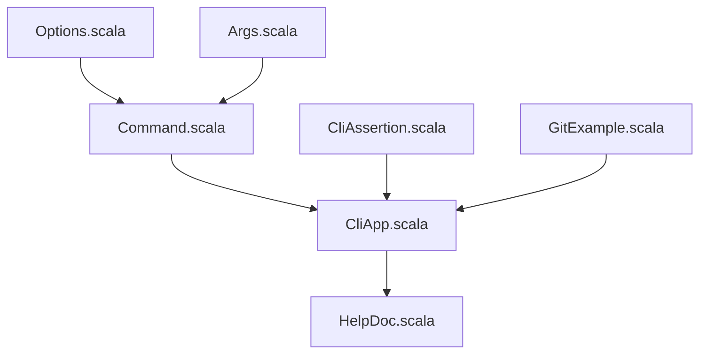

# zio/zio-cli

> Bibliothèque Scala pour construire des applications en ligne de commande sur ZIO.

## Le problème
Écrire à la main l'analyse d'arguments, l'aide et la validation d'un CLI est fastidieux.

## Ce que ça fait vraiment
On combine `Options` et `Args` dans une `Command`, passée à `CliApp.make`, qui produit aide, validation et exécution. Les sous-commandes sont prises en charge. Des fichiers spécifiques adaptent le noyau à la JVM, JS et Native. Un testkit permet de tester les CLI.

## Comment c'est branché
Schéma d'après le diagramme du code.



## Essayer
```bash
# build.sbt :
# libraryDependencies += "dev.zio" %% "zio-cli" % "0.8.2"
```

## Coût et pièges
Gratuit. Scala, sbt et l'écosystème ZIO sont nécessaires.

## Ce que ce n'est pas
Pas un outil CLI prêt à l'emploi : une bibliothèque pour en écrire en Scala.

## Alternatives
Aucune citée dans le README.

## Pour toi
Ignorer : utile uniquement si tu écris des CLI en Scala/ZIO.

