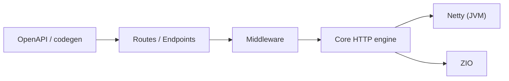

# zio/zio-http

> Scala framework for typed HTTP servers and clients, built on ZIO and Netty.

## The problem
Writing HTTP services in functional Scala requires a framework that is composable, testable and type-safe.

## What it actually does
"HTTP as a function" model: imperative routes or declarative endpoints, middleware (logs, metrics, auth), WebSockets, typed errors, codecs via ZIO Schema (JSON, Protobuf, Avro, Thrift), an HTML template DSL, OpenAPI in both directions, CLI, a testkit that needs no real server. JVM module on Netty, plus a JS module.

## How it is wired


## Trying it
```scala
libraryDependencies += "dev.zio" %% "zio-http" % "3.3.2"
```
Then the README's `GreetingServer` example (`Server.serve(routes).provide(Server.default)`).

## Cost and gotchas
Free. Versions 1.x/2.x were published under the `io.d11` organization (Dream11), and the numbering changed afterwards: watch out for the coordinates.

## What it is not
Not a data tool: it is a Scala web framework. ZIO has a learning curve.

## Alternatives
None named in the README.

## For you
Ignore unless your stack is Scala/ZIO: little connection with everyday data/AI work.
