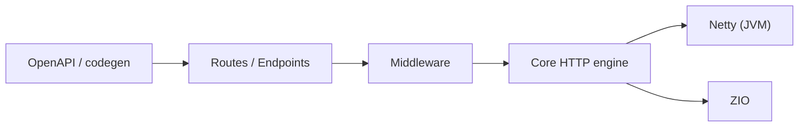

# zio/zio-http

> Framework Scala pour serveurs et clients HTTP typés, bâti sur ZIO et Netty.

## Le problème
Écrire des services HTTP en Scala fonctionnel demande un framework composable, testable et sûr au niveau des types.

## Ce que ça fait vraiment
Modèle « HTTP comme fonction » : routes impératives ou endpoints déclaratifs, middleware (logs, métriques, auth), WebSockets, erreurs typées, codecs via ZIO Schema (JSON, Protobuf, Avro, Thrift), DSL de templates HTML, OpenAPI dans les deux sens, CLI, testkit sans serveur réel. Module JVM sur Netty, module JS.

## Comment c'est branché


## Essayer
```scala
libraryDependencies += "dev.zio" %% "zio-http" % "3.3.2"
```
Puis l'exemple `GreetingServer` du README (`Server.serve(routes).provide(Server.default)`).

## Coût et pièges
Gratuit. Versions 1.x/2.x publiées sous l'organisation `io.d11` (Dream11), numérotation changée ensuite : attention aux coordonnées.

## Ce que ce n'est pas
Pas un outil data : un framework web Scala. Courbe d'apprentissage ZIO.

## Alternatives
Aucune nommée dans le README.

## Pour toi
À ignorer sauf si ta pile est en Scala/ZIO : peu de lien avec le travail data/IA courant.

