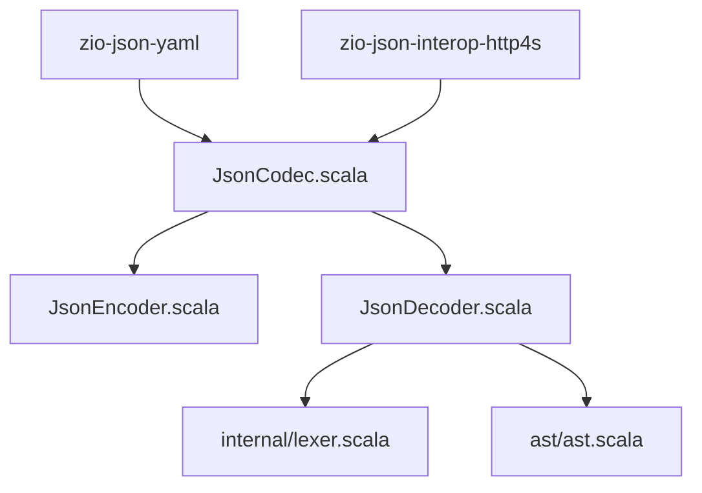

# zio/zio-json

> Fast and safe JSON library for Scala, integrated with ZIO.

## The problem
Encode and decode JSON in Scala without slow compilation (shapeless) or exposure to hostile payloads.

## What it actually does
`JsonCodec` combines `JsonEncoder` and `JsonDecoder`; the decoder relies on an internal lexer and the JSON AST. JVM- and JS-specific sources, plus YAML, http4s and golden add-on modules. Stated goals: performance, security, fast compilation, readable errors. No performance figures in the README.

## How it is wired


## Trying it
```bash
# build.sbt :
# libraryDependencies += "dev.zio" %% "zio-json" % "1.1.1"
```

## Cost and gotchas
Scala/sbt project. The version 1.1.1 cited in the README is probably outdated; check the latest one. Scala.js and Scala Native require `%%%`.

## What it is not
Not a Python library nor a data analysis tool.

## Alternatives
No alternative named in the README.

## For you
Ignore: concerns the Scala/ZIO ecosystem; useful only if your data services are written in Scala.
