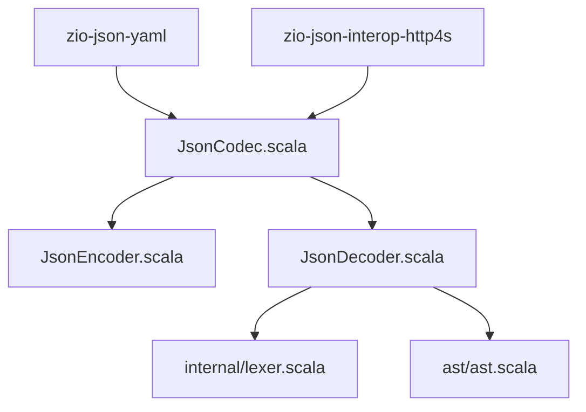

# zio/zio-json

> Bibliothèque JSON rapide et sûre pour Scala, intégrée à ZIO.

## Le problème
Encoder et décoder du JSON en Scala sans compilation lente (shapeless) ni exposition à des charges hostiles.

## Ce que ça fait vraiment
`JsonCodec` combine `JsonEncoder` et `JsonDecoder` ; le décodeur s'appuie sur un lexer interne et l'AST JSON. Sources spécifiques JVM et JS, modules annexes YAML, http4s et golden. Objectifs affichés : performance, sécurité, compilation rapide, erreurs lisibles. Aucun chiffre de performance dans le README.

## Comment c'est branché


## Essayer
```bash
# build.sbt :
# libraryDependencies += "dev.zio" %% "zio-json" % "1.1.1"
```

## Coût et pièges
Projet Scala/sbt. La version 1.1.1 citée dans le README est probablement obsolète ; vérifier la dernière. Scala.js et Scala Native demandent `%%%`.

## Ce que ce n'est pas
Pas une bibliothèque Python ni un outil d'analyse de données.

## Alternatives
Aucune alternative nommée dans le README.

## Pour toi
Ignorer : concerne l'écosystème Scala/ZIO ; utile seulement si tes services data sont écrits en Scala.

