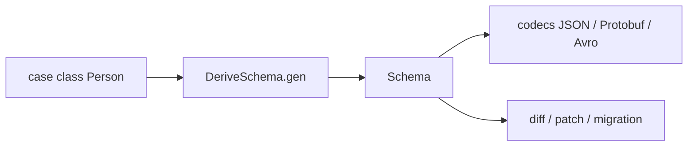

# zio/zio-schema

> Scala ZIO library that models the structure of types as values to generate codecs, diffs and migrations.

## The problem
Hand-writing serialization, deserialization and data migration for every type is repetitive and fragile.

## What it actually does
Derives a schema from case classes and sealed traits, with no macros or reflection at runtime. That schema is used to produce codecs (JSON, Protobuf, Avro, BSON, MessagePack, Thrift), derive typeclasses, compute diffs and patches, and migrate values between types. Used by ZIO Flow, Redis, SQL and DynamoDB.

## How it is wired


## Trying it
```bash
# build.sbt
# libraryDependencies += "dev.zio" %% "zio-schema" % "1.9.0"
sbt prepare
sbt test
```

## Cost and gotchas
Free. Requires Scala and the ZIO ecosystem; automatic derivation needs zio-schema-derivation and scala-reflect.

## What it is not
Not a Python or Spark schema library. The README promises "ETL" features but documents no pipeline.

## Alternatives
No alternative named in the README.

## For you
Ignore unless your data stack is Scala/ZIO: otherwise it has no value for you.
