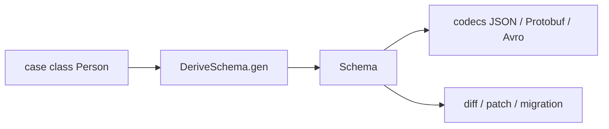

# zio/zio-schema

> Bibliothèque Scala ZIO qui modélise la structure des types comme valeurs pour générer codecs, diffs et migrations.

## Le problème
Écrire à la main sérialisation, désérialisation et migration de données pour chaque type est répétitif et fragile.

## Ce que ça fait vraiment
Dérive un schéma à partir de case classes et sealed traits, sans macros ni réflexion à l'usage. Ce schéma sert à produire des codecs (JSON, Protobuf, Avro, BSON, MessagePack, Thrift), dériver des typeclasses, calculer des diffs et patchs, et migrer des valeurs entre types. Utilisé par ZIO Flow, Redis, SQL et DynamoDB.

## Comment c'est branché


## Essayer
```bash
# build.sbt
# libraryDependencies += "dev.zio" %% "zio-schema" % "1.9.0"
sbt prepare
sbt test
```

## Coût et pièges
Gratuit. Nécessite Scala et l'écosystème ZIO ; la dérivation automatique demande zio-schema-derivation et scala-reflect.

## Ce que ce n'est pas
Pas une bibliothèque de schémas Python ou Spark. Le README promet des fonctions « ETL » mais ne documente pas de pipeline.

## Alternatives
Aucune alternative nommée dans le README.

## Pour toi
Ignorer sauf si ton stack data est en Scala/ZIO : sinon aucune valeur pour toi.

