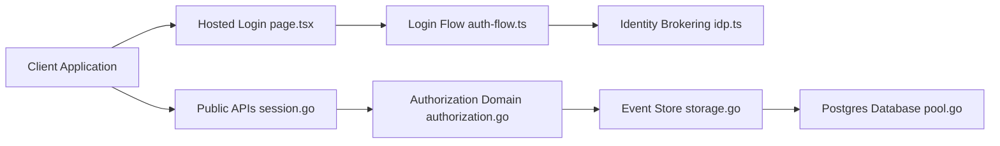

# zitadel/zitadel

> Self-hostable identity and access platform (SSO, MFA, OIDC, SAML), designed to be multi-tenant for B2B products.

## The problem
Wiring SSO, MFA, passkeys and isolated customer organizations into a product takes months, and SaaS offerings lock you in.

## What it actually does
API-first IAM server (gRPC, connectRPC, REST) with an Instances → Organizations → Projects hierarchy.
Every mutation is written as an immutable event: a complete audit trail, exportable through webhooks.
Hosted login (Login V2), federation of external IdPs, SCIM 2.0, actions/webhooks, admin console.
PostgreSQL ≥ 14 storage; same code in the cloud and self-hosted.

## How it is wired


## Trying it
```bash
curl -LO https://raw.githubusercontent.com/zitadel/zitadel/main/deploy/compose/docker-compose.yml \
  && curl -LO https://raw.githubusercontent.com/zitadel/zitadel/main/deploy/compose/.env.example \
  && cp .env.example .env \
  && docker compose up -d --wait
```

## Cost and gotchas
Self-hosted is free (Docker + PostgreSQL); ZITADEL Cloud is pay-as-you-go. Paid professional support.

## What it is not
Not a simple auth library to embed: it is a service you have to operate. AGPL: modifying and exposing the code requires publishing it.

## Alternatives
- Keycloak: open source and self-hostable, more widespread, but realms scale less well according to the README.
- FusionAuth: native tenants, but not open source.
- Auth0/Okta: SaaS with no self-hosting.

## For you
Worth watching: useful if you must expose a multi-customer ML platform with SSO, off-topic for an internal data pipeline.
