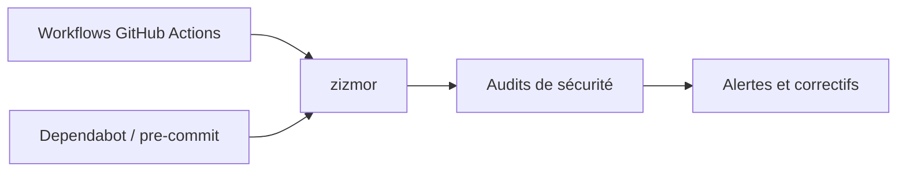

# zizmorcore/zizmor

> A CI/CD static analyzer that detects GitHub Actions vulnerabilities, for anyone maintaining workflows.

## The problem
A poorly written workflow exposes secrets or runs injected code, and these flaws go unnoticed during review.

## What it actually does
It reads GitHub Actions, Dependabot and pre-commit workflow files, and flags template injections, persisted or leaked credentials, overly broad permissions, and impostor commits or ambiguous git references. It can also suggest fixes. The details of the rules are in the online documentation.

## How it is wired
Simplified diagram based on the fiche, no diagram provided.

## Trying it
The README gives no command: it points to docs.zizmor.sh (installation, quickstart, usage).

## Cost and gotchas
Free. Installation and usage must be read in the external documentation, the README being minimal. 175 open issues.

## What it is not
Not an application code scanner: it only looks at CI/CD configuration. It does not replace a human review of workflows.

## Alternatives
No alternative named in the README.

## For you
Adopt: your MLOps repos publish via GitHub Actions, and this static check costs little to close common flaws.
