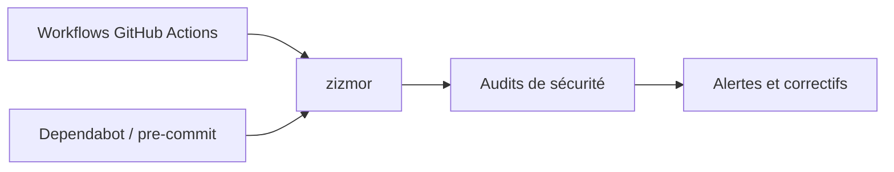

# zizmorcore/zizmor

> Un analyseur statique de CI/CD qui détecte les failles de GitHub Actions, pour qui maintient des workflows.

## Le problème
Un workflow mal écrit expose des secrets ou exécute du code injecté, et ces failles passent inaperçues à la relecture.

## Ce que ça fait vraiment
Il lit les fichiers de workflow GitHub Actions, de Dependabot et de pre-commit, et signale les injections de modèle, les identifiants persistants ou divulgués, les permissions trop larges et les commits imposteurs ou références git confuses. Il peut aussi proposer des correctifs. Le détail des règles est dans la documentation en ligne.

## Comment c'est branché
Schéma simplifié d'après la fiche, sans diagramme fourni.

## Essayer
Le README ne donne aucune commande : il renvoie à docs.zizmor.sh (installation, quickstart, usage).

## Coût et pièges
Gratuit. Installation et usage à lire dans la documentation externe, le README étant minimal. 175 issues ouvertes.

## Ce que ce n'est pas
Pas un scanner de code applicatif : il ne regarde que la configuration CI/CD. Il ne remplace pas une revue humaine des workflows.

## Alternatives
Aucune alternative nommée dans le README.

## Pour toi
À adopter : tes dépôts MLOps publient via GitHub Actions, et ce contrôle statique coûte peu pour fermer des failles courantes.

