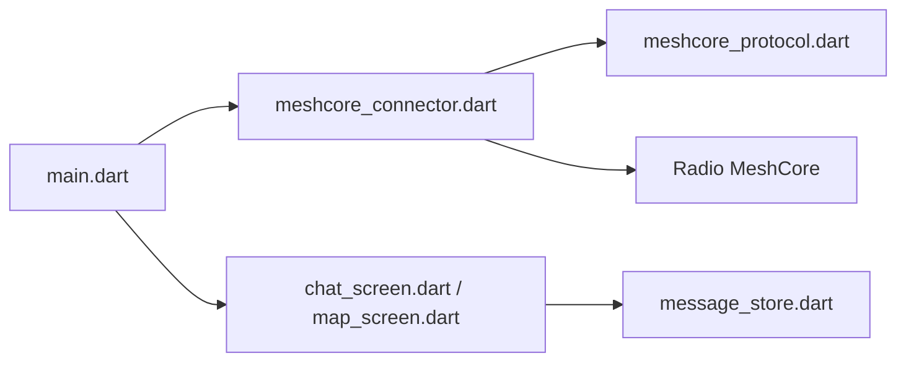

# zjs81/meshcore-open

> Open-source Flutter client for MeshCore LoRa radios, for off-grid messaging over Bluetooth, USB or TCP.

## The problem
Communicating without a mobile network requires a mesh radio and an app to drive it. This app serves as the interface to those radios.

## What it actually does
It connects to a MeshCore radio (BLE via Nordic UART, USB serial, TCP), syncs contacts and channels, then sends encrypted direct or channel messages, compressed images and reactions. It shows a map of nodes, manages routes and repeaters, tunes the radio (frequency, bandwidth, spreading factor) and translates locally via llamadart. Storage in JSON in SharedPreferences.

## How it is wired


## Trying it
```bash
git clone https://github.com/zjs81/meshcore-open.git
cd meshcore-open
flutter pub get
flutter run
flutter build web --release
flutter build apk --release
```

## Cost and gotchas
Free, but you need a radio compatible with the companion firmware. The web client works in Chrome only (Web Serial, no BLE/TCP). Offline maps: Stadia Maps API key. 109 open issues.

## What it is not
Not an AI or data tool: it is a radio messaging client. It does not work without LoRa hardware.

## Alternatives
No alternative cited in the README.

## For you
Ignore for a data/AI/MLOps profile: a radio client unrelated to your scope, useful only if you own MeshCore hardware.
