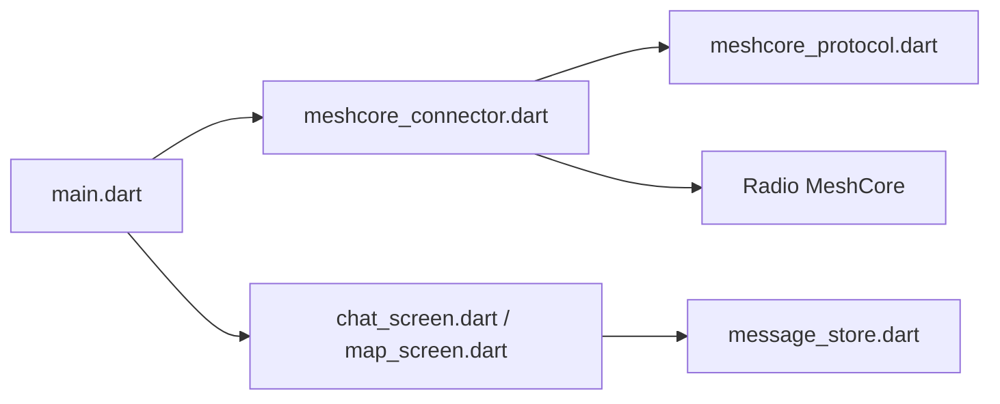

# zjs81/meshcore-open

> Client Flutter open source pour radios LoRa MeshCore, pour messagerie hors réseau en Bluetooth, USB ou TCP.

## Le problème
Communiquer hors réseau mobile exige une radio maillée et une application pour la piloter. Cette appli sert d'interface à ces radios.

## Ce que ça fait vraiment
Elle se connecte à une radio MeshCore (BLE via Nordic UART, USB série, TCP), synchronise contacts et canaux, puis envoie des messages directs chiffrés ou en canal, des images compressées et des réactions. Elle affiche une carte des nœuds, gère routes et répéteurs, règle la radio (fréquence, bande passante, facteur d'étalement) et traduit en local via llamadart. Stockage en JSON dans SharedPreferences.

## Comment c'est branché


## Essayer
```bash
git clone https://github.com/zjs81/meshcore-open.git
cd meshcore-open
flutter pub get
flutter run
flutter build web --release
flutter build apk --release
```

## Coût et pièges
Gratuit, mais il faut une radio compatible avec le firmware compagnon. Le client web fonctionne dans Chrome seulement (Web Serial, pas de BLE/TCP). Cartes hors ligne : clé d'API Stadia Maps. 109 issues ouvertes.

## Ce que ce n'est pas
Pas un outil IA ni data : c'est un client de messagerie radio. Il ne fonctionne pas sans matériel LoRa.

## Alternatives
Aucune alternative citée dans le README.

## Pour toi
À ignorer pour un profil data/IA/MLOps : c'est un client radio sans lien avec ton périmètre, utile seulement si tu possèdes du matériel MeshCore.

