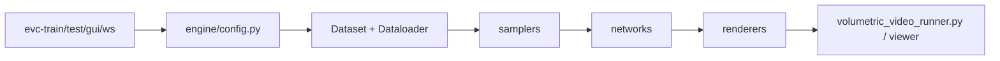

# zju3dv/EasyVolcap

> PyTorch library for neural volumetric video research: capture, reconstruction, rendering.

## The problem
Every dynamic neural rendering paper (NeRF, temporal 3DGS) reimplements its data, its config and its viewer.

## What it actually does
A modular framework where a batch of data goes through a `sampler`, a `network` and a `renderer` chosen via YAML files. It provides Instant-NGP+T, 3DGS+T and ENeRFi, the commands `evc-train`, `evc-test`, `evc-gui`, `evc-ws`, an OpenGL viewer and WebSocket rendering. The data is simply images plus `intri.yml` and `extri.yml`.

## How it is wired


## Trying it
```bash
pip install -v -e .
evc-test -c configs/exps/enerfi/enerfi_${expname}.yaml,configs/specs/spiral.yaml,configs/specs/ibr.yaml runner_cfg.visualizer_cfg.save_tag=${expname} exp_name=enerfi_dtu
evc-train -c configs/exps/l3mhet/l3mhet_${expname}.yaml
```

## Cost and gotchas
Free, but a CUDA GPU is required; Instant-NGP+T requires `tiny-cuda-nn`, 3DGS+T requires `diff_gaussian_rasterization`. On Windows, you can end up with a CPU-only PyTorch without meaning to. The sample dataset and models are on Google Drive.

## What it is not
Not a product: the documentation is marked as work in progress and the README is cut off mid code block. The authors advise forking rather than importing the library.

## Alternatives
Nerfstudio, cited among the works the project draws inspiration from.

## For you
Ignore unless you do 3D vision research: very specialized niche, license present but not identified, GPU mandatory.
