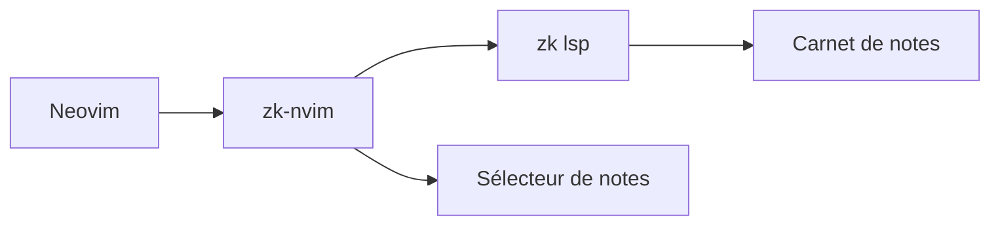

# zk-org/zk-nvim

> Neovim extension for the plain-text note tool `zk`, with navigation, links and search.

## The problem
Managing a notebook of linked Markdown notes from the editor requires integrated commands and search views.

## What it actually does
Connects Neovim to the `zk` LSP client. Commands `:ZkNew`, `:ZkNotes`, `:ZkBacklinks`, `:ZkLinks`, `:ZkTags`, `:ZkInsertLink` and `:ZkMatch`. Possible pickers: Telescope, fzf, mini.pick, snacks.picker or `vim.ui.select`. Lua API for writing your own commands. Neovim 0.11 or later and `zk` 0.15.1 or later are required.

## How it is wired
Simplified diagram based on the fiche, no diagram provided.


## Trying it
```lua
{
  "zk-org/zk-nvim",
  name = "zk",
  opts = {
    picker = "select",
  },
}
```
```vim
:ZkNew { dir = "daily", date = "yesterday" }
:ZkNotes { createdAfter = "3 days ago", tags = { "work" } }
```

## Cost and gotchas
Free. The `zk` CLI must be installed (no need to go through Mason if it is) and a notebook found by buffer path, current directory or `$ZK_NOTEBOOK_DIR`. No key mapping is added.

## What it is not
Not a standalone note tool: it is a client for `zk`. No AI and no synchronization.

## Alternatives
No alternative named in the README.

## For you
Ignore unless you take notes in Neovim with `zk`: of no direct interest for data or MLOps.
