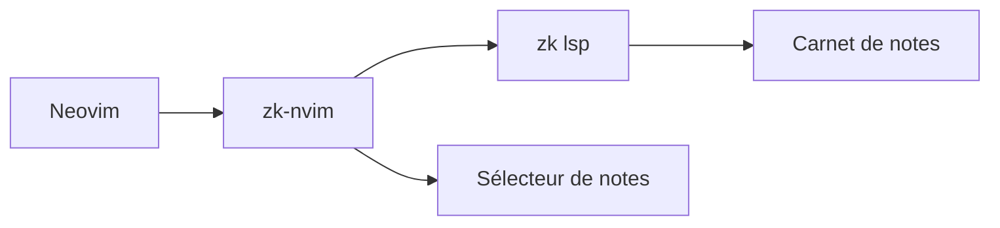

# zk-org/zk-nvim

> Extension Neovim pour l'outil de notes en texte brut `zk`, avec navigation, liens et recherche.

## Le problème
Gérer un carnet de notes Markdown liées depuis l'éditeur demande des commandes et des vues de recherche intégrées.

## Ce que ça fait vraiment
Branche Neovim sur le client LSP de `zk`. Commandes `:ZkNew`, `:ZkNotes`, `:ZkBacklinks`, `:ZkLinks`, `:ZkTags`, `:ZkInsertLink` et `:ZkMatch`. Sélecteurs possibles : Telescope, fzf, mini.pick, snacks.picker ou `vim.ui.select`. API Lua pour écrire ses commandes. Neovim 0.11 ou plus et `zk` 0.15.1 ou plus sont requis.

## Comment c'est branché
Schéma simplifié d'après la fiche, sans diagramme fourni.


## Essayer
```lua
{
  "zk-org/zk-nvim",
  name = "zk",
  opts = {
    picker = "select",
  },
}
```
```vim
:ZkNew { dir = "daily", date = "yesterday" }
:ZkNotes { createdAfter = "3 days ago", tags = { "work" } }
```

## Coût et pièges
Gratuit. Il faut le CLI `zk` installé (inutile de passer par Mason si c'est le cas) et un carnet retrouvé par chemin du tampon, répertoire courant ou `$ZK_NOTEBOOK_DIR`. Aucun raccourci clavier n'est ajouté.

## Ce que ce n'est pas
Pas un outil de notes autonome : c'est un client pour `zk`. Pas d'IA ni de synchronisation.

## Alternatives
Aucune alternative nommée dans le README.

## Pour toi
À ignorer sauf si tu prends tes notes sous Neovim avec `zk` : sans intérêt direct pour la data ou le MLOps.

