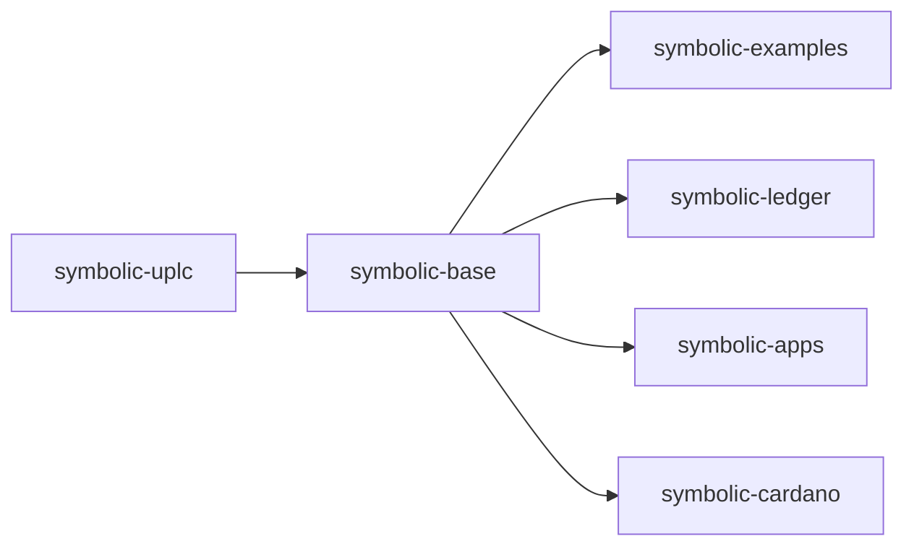

# zkFold/symbolic

> Haskell framework that generates zero-knowledge circuits from high-level code.

## The problem
Writing zero-knowledge circuits by hand is slow and error-prone.

## What it actually does
The developer writes the business logic in Haskell and the framework produces the corresponding circuits, via a general intermediate representation compatible with several proof systems. Packages: `symbolic-base`, `symbolic-examples`, `symbolic-ledger`, `symbolic-apps`, `symbolic-cardano`, `symbolic-uplc`.

## How it is wired
Simplified diagram based on the sheet, no diagram provided.


## Trying it
```bash
cabal build all
cabal test all
cabal bench all
```

## Cost and gotchas
GHC 9.12.1 and Cabal 3.14.1.1 required (Haskell, not in the list). Oriented toward the Cardano blockchain.

## What it is not
Not a machine learning tool: zero-knowledge proofs for contracts and ledgers.

## Alternatives
None named in the README.

## For you
Ignore: Haskell cryptography for Cardano, with no foreseeable use in data/AI/MLOps.
