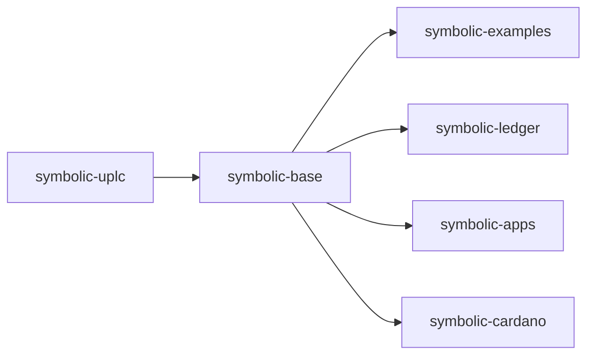

# zkFold/symbolic

> Framework Haskell qui génère des circuits à divulgation nulle de connaissance depuis du code de haut niveau.

## Le problème
Écrire des circuits zero-knowledge à la main est long et propice aux erreurs.

## Ce que ça fait vraiment
Le développeur écrit la logique métier en Haskell et le framework produit les circuits correspondants, via une représentation intermédiaire générale compatible avec plusieurs systèmes de preuve. Paquets : `symbolic-base`, `symbolic-examples`, `symbolic-ledger`, `symbolic-apps`, `symbolic-cardano`, `symbolic-uplc`.

## Comment c'est branché
Schéma simplifié d'après la fiche, sans diagramme fourni.


## Essayer
```bash
cabal build all
cabal test all
cabal bench all
```

## Coût et pièges
GHC 9.12.1 et Cabal 3.14.1.1 exigés (Haskell, hors liste). Orienté blockchain Cardano.

## Ce que ce n'est pas
Pas un outil de machine learning : de la preuve à divulgation nulle pour contrats et registres.

## Alternatives
Aucune nommée dans le README.

## Pour toi
À ignorer : cryptographie Haskell pour Cardano, sans usage prévisible en data/IA/MLOps.

