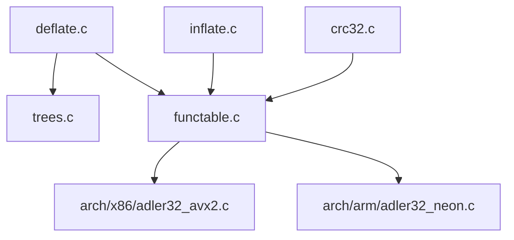

# zlib-ng/zlib-ng

> Modern, compatible and markedly faster fork of zlib thanks to SIMD instructions, for deflate compression.

## The problem
zlib, portable but burdened with historical workarounds, is slow and hard to optimize for recent processors.

## What it actually does
Keeps the zlib API (compatible mode optional) with a native API modernized in C11, fast and medium deflate strategies, Intel and Cloudflare optimizations, and implementations of adler32, crc32, slide hash and inflate copy with SSE, AVX2, AVX512, Neon, Power, s390x, LoongArch and RISC-V. `functable.c` picks the variants at runtime. The README claims roughly four times faster than zlib on x86-64.

## How it is wired


## Trying it
```bash
cmake .
cmake --build . --config Release
ctest --verbose -C Release
```

## Cost and gotchas
Free, very permissive Zlib license. Do not replace the system zlib without care; prefer an `/opt/` prefix or `LD_PRELOAD` for a trial. The 4x gain is the author's own measurement, to be verified.

## What it is not
Not a new compression format: it produces standard deflate/zlib. Not a replacement to install blindly.

## Alternatives
No alternative named in the README (original zlib, and minizip-ng for minizip).

## For you
Adopt for infrastructure: a proven, faster compression building block, useful for data pipelines that compress a lot, via your distribution's or image's packages.
