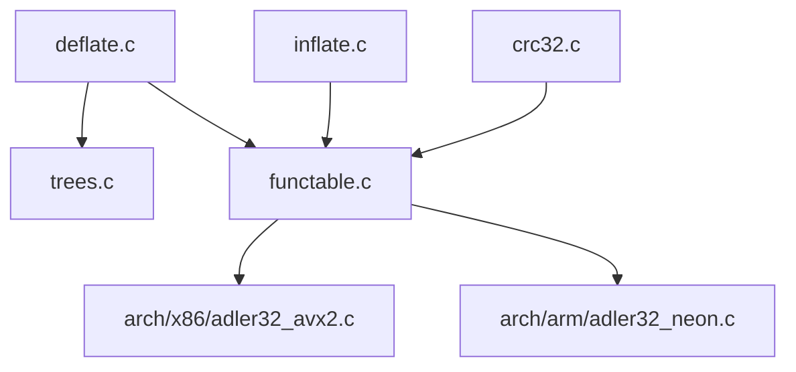

# zlib-ng/zlib-ng

> Fork moderne de zlib, compatible et nettement plus rapide grâce aux instructions SIMD, pour la compression deflate.

## Le problème
zlib, portable mais chargé de contournements historiques, est lent et difficile à optimiser pour les processeurs récents.

## Ce que ça fait vraiment
Reprend l'API zlib (mode compatible en option) avec une API native modernisée en C11, des stratégies de deflate rapide et moyenne, des optimisations Intel et Cloudflare, et des implémentations de adler32, crc32, slide hash et copie d'inflate avec SSE, AVX2, AVX512, Neon, Power, s390x, LoongArch et RISC-V. `functable.c` choisit les variantes à l'exécution. Le README annonce environ quatre fois plus vite que zlib sur x86-64.

## Comment c'est branché


## Essayer
```bash
cmake .
cmake --build . --config Release
ctest --verbose -C Release
```

## Coût et pièges
Gratuit, licence Zlib très permissive. Ne pas remplacer la zlib du système sans précaution ; préférer le préfixe `/opt/` ou `LD_PRELOAD` pour un essai. Le gain de 4 fois est une mesure de l'auteur, à vérifier.

## Ce que ce n'est pas
Pas un nouveau format de compression : il produit du deflate/zlib standard. Pas un remplaçant à installer à l'aveugle.

## Alternatives
Aucune alternative nommée dans le README (zlib d'origine, et minizip-ng pour minizip).

## Pour toi
À adopter pour l'infrastructure : brique de compression éprouvée et plus rapide, utile aux chaînes de données qui compressent beaucoup, via les paquets de ta distribution ou de ton image.

