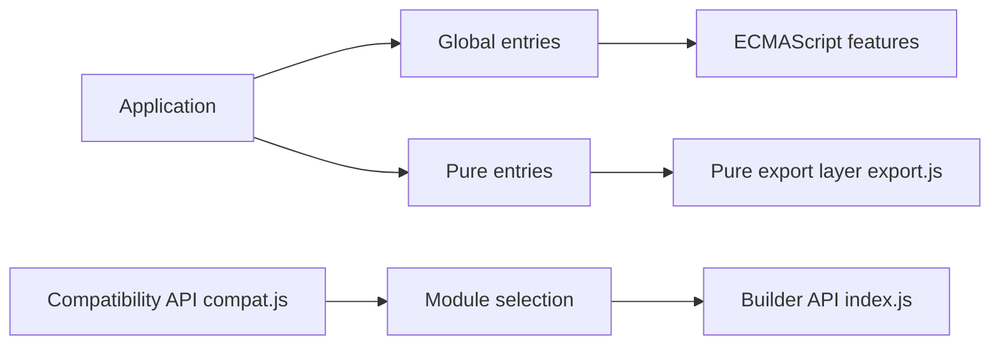

# zloirock/core-js

> Modular JavaScript polyfill library (ECMAScript, TC39 proposals, web standards), for front-end and Node developers.

## The problem
JavaScript engines do not all implement the same features: you write modern code that breaks on older browsers.

## What it actually does
Adds missing features only if the engine does not provide them or handles them badly: promises, collections, iterators, typed arrays, `URL`, `structuredClone`, up to ECMAScript 2025 and proposals at several stages. Three packages: `core-js` (global), `core-js-pure` (no prototype pollution), `core-js-bundle`. Integrates with Babel (`useBuiltIns`) and swc.

## How it is wired


## Trying it
```bash
npm install --save core-js@3.50.0
npm install --save core-js-pure@3.50.0
ADBLOCK=true npm install
```
```js
import 'core-js/actual';
```

## Cost and gotchas
Free. A message is displayed after installation asking for donations (`postinstall`, can be disabled). Many small modules: better to go through a bundler than to load each file.

## What it is not
Not a transpiler: syntax (`using`) requires a separate tool. `BigInt`, `Proxy`, and `Intl` cannot be polyfilled, according to the README. The project depends on no company: its funding comes from sponsors.

## Alternatives
- JSBI: for `BigInt`.
- proxy-polyfill: a subset of `Proxy`.
- unorm: for `String#normalize`.

## For you
Adopt if you ship JavaScript for varied targets: it is the reference polyfill of the Babel ecosystem, but depends on a single person.
