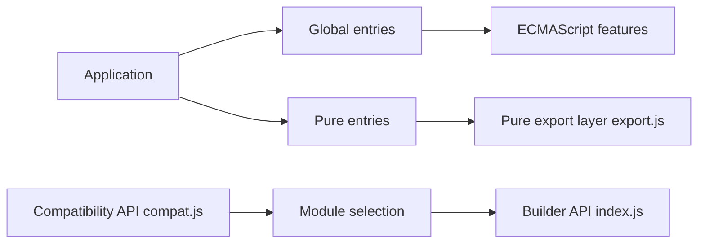

# zloirock/core-js

> Bibliothèque modulaire de polyfills JavaScript (ECMAScript, propositions TC39, standards web), pour développeurs front et Node.

## Le problème
Les moteurs JavaScript n'implémentent pas tous les mêmes fonctions : tu écris du code moderne qui casse sur d'anciens navigateurs.

## Ce que ça fait vraiment
Ajoute les fonctionnalités manquantes seulement si le moteur ne les fournit pas ou les gère mal : promesses, collections, itérateurs, tableaux typés, `URL`, `structuredClone`, jusqu'à ECMAScript 2025 et des propositions de plusieurs stades. Trois paquets : `core-js` (global), `core-js-pure` (sans pollution des prototypes), `core-js-bundle`. S'intègre à Babel (`useBuiltIns`) et à swc.

## Comment c'est branché


## Essayer
```bash
npm install --save core-js@3.50.0
npm install --save core-js-pure@3.50.0
ADBLOCK=true npm install
```
```js
import 'core-js/actual';
```

## Coût et pièges
Gratuit. Un message est affiché après installation pour demander des dons (`postinstall`, désactivable). Beaucoup de petits modules : mieux vaut passer par un bundler plutôt que charger chaque fichier.

## Ce que ce n'est pas
Pas un transpileur : la syntaxe (`using`) demande un outil à part. `BigInt`, `Proxy` et `Intl` ne sont pas polyfillables, selon le README. Le projet ne dépend d'aucune entreprise : son financement vient de sponsors.

## Alternatives
- JSBI : pour `BigInt`.
- proxy-polyfill : sous-ensemble de `Proxy`.
- unorm : pour `String#normalize`.

## Pour toi
À adopter si tu livres du JavaScript pour des cibles variées : c'est le polyfill de référence de l'écosystème Babel, mais dépend d'une seule personne.

