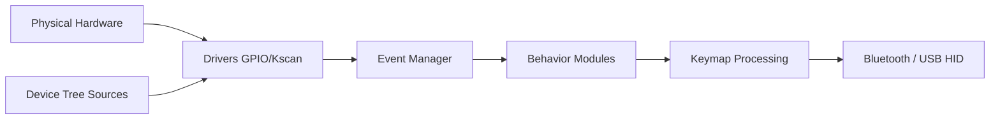

# zmkfirmware/zmk

> Open source firmware for wireless mechanical keyboards on Zephyr RTOS, for manufacturers and enthusiasts.

## The problem
Existing keyboard firmwares have license and wireless problems; ZMK aims to be a modern, free firmware.

## What it actually does
Zephyr firmware: matrix scanning, event manager, behaviors (hold-tap, macros, combos), Bluetooth and USB HID, split keyboards (wireless or wired), displays and widgets, keymap via device tree. The README is very short; the detail comes from the code.

## How it is wired

## Trying it
No command documented in the README: see zmk.dev.

## Cost and gotchas
Free; a compatible keyboard and the Zephyr build toolchain are needed. README under 800 characters.

## What it is not
Not desktop software: embedded firmware to compile.

## Alternatives
No alternative named in the README.

## For you
Ignore: a hardware domain unrelated to your profile, unless you are passionate about keyboards.
