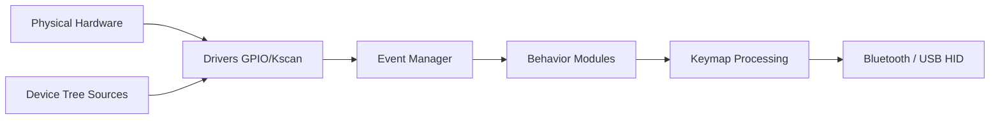

# zmkfirmware/zmk

> Firmware open source de claviers mécaniques sans fil sur Zephyr RTOS, pour fabricants et passionnés.

## Le problème
Les firmwares de clavier existants posent des problèmes de licence et de sans-fil ; ZMK vise un firmware moderne et libre.

## Ce que ça fait vraiment
Firmware Zephyr : scan de la matrice, gestionnaire d'événements, comportements (hold-tap, macros, combos), Bluetooth et USB HID, claviers split (sans fil ou filaire), écrans et widgets, keymap par device tree. Le README est très bref ; le détail vient du code.

## Comment c'est branché

## Essayer
Aucune commande documentée dans le README : voir zmk.dev.

## Coût et pièges
Gratuit ; un clavier compatible et la chaîne de compilation Zephyr. README sous 800 caractères.

## Ce que ce n'est pas
Pas un logiciel de bureau : du firmware embarqué à compiler.

## Alternatives
Aucune alternative nommée dans le README.

## Pour toi
À ignorer : domaine matériel sans rapport avec ton profil, sauf passion pour les claviers.

