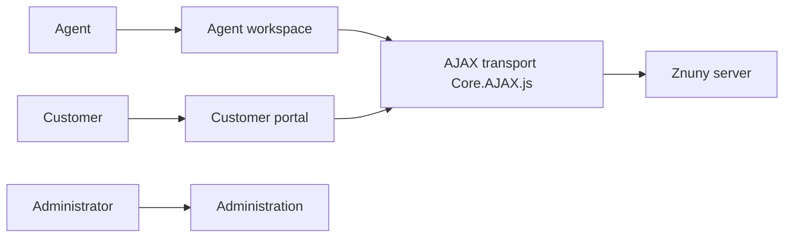

# znuny/Znuny

> Ticketing system derived from the community edition of OTRS 6.0.30, maintained by Znuny GmbH.

## The problem
OTRS Community Edition reached end of life in December 2020: support teams had to find a maintained suite.

## What it actually does
Znuny is a Perl web helpdesk: ticket search, view and actions, processes, dashboard, calendar, statistics, customer portal, administration and web services. The code sampled here is the browser JavaScript (initialization, AJAX, interface components). Installation requires Linux, Perl 5.16 or later, a web server and a MySQL, MariaDB, PostgreSQL or Oracle database.

## How it is wired

## Trying it
No command documented in the README provided: it points to the project documentation.

## Cost and gotchas
Free software under GPL v3, funded by Znuny GmbH, which sells support. Database and Apache server with mod_perl to install and operate.

## What it is not
Not a data analysis or AI tool: it is a classic ticket management system.

## Alternatives
The README names no alternative.

## For you
Ignore: customer support tool, outside your data, AI or MLOps scope.
