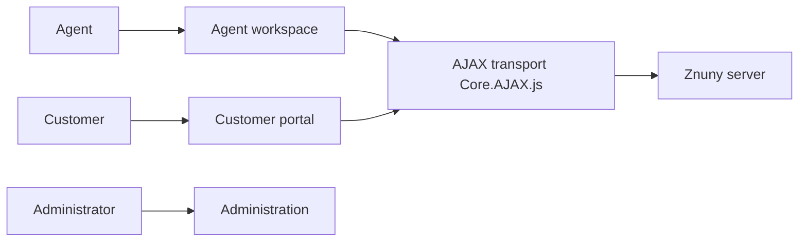

# znuny/Znuny

> Système de tickets issu de la version communautaire d'OTRS 6.0.30, maintenu par Znuny GmbH.

## Le problème
OTRS Community Edition est arrivé en fin de vie en décembre 2020 : les équipes de support devaient trouver une suite maintenue.

## Ce que ça fait vraiment
Znuny est un helpdesk web en Perl : recherche, vue et actions sur les tickets, processus, tableau de bord, calendrier, statistiques, portail client, administration et services web. Le code échantillonné ici est le JavaScript du navigateur (initialisation, AJAX, composants d'interface). L'installation demande Linux, Perl 5.16 ou plus, un serveur web et une base MySQL, MariaDB, PostgreSQL ou Oracle.

## Comment c'est branché

## Essayer
Aucune commande documentée dans le README fourni : il renvoie vers la documentation du projet.

## Coût et pièges
Logiciel gratuit en GPL v3, financé par Znuny GmbH qui vend du support. Base de données et serveur Apache avec mod_perl à installer et exploiter.

## Ce que ce n'est pas
Pas un outil d'analyse de données ni d'IA : c'est un système de gestion de tickets classique.

## Alternatives
Le README ne nomme pas d'alternative.

## Pour toi
Ignorer : outil de support client, hors de ton périmètre data, IA ou MLOps.

