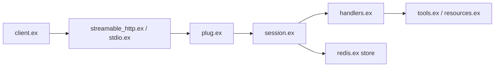

# zoedsoupe/anubis-mcp

> Elixir SDK for the Model Context Protocol with clients and servers, for developers exposing tools to LLMs.

## The problem
Writing an MCP server or client in Elixir by hand means handling the protocol, transports and sessions yourself.

## What it actually does
Elixir library: servers defined by components (tools, resources, prompts) registered at compile time or dynamically, a client with STDIO and Streamable HTTP transports, a Phoenix/Plug plug, persistent sessions (Redis store), tasks, authorization, sampling and elicitation. Multiple protocol versions, with a written deprecation policy.

## How it is wired


## Trying it
```elixir
{:anubis_mcp, "~> 2.2.0"}

use Anubis.Server.Component, type: :tool
children = [{MyApp.MCPServer, transport: :streamable_http}]
forward "/mcp", Anubis.Server.Transport.StreamableHTTP.Plug, server: MyApp.MCPServer
```
(In `mix.exs` for the dependency; the rest goes in the application.)

## Cost and gotchas
Free. You need an Elixir project. A license is present but not identified by GitHub: to be checked. The README claims "high-performance" with no measurement provided.

## What it is not
Not a ready-to-use MCP server: it is an SDK. Only useful in the Elixir ecosystem.

## Alternatives
No alternative cited in the README.

## For you
Watch: relevant if your stack is Elixir/Phoenix, otherwise prefer an MCP SDK in your language; check the license.
