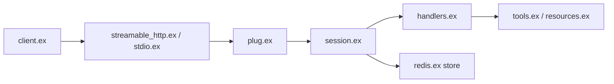

# zoedsoupe/anubis-mcp

> SDK Elixir du Model Context Protocol avec clients et serveurs, pour développeurs qui exposent des outils à des LLM.

## Le problème
Écrire un serveur ou un client MCP en Elixir à la main impose de gérer le protocole, les transports et les sessions.

## Ce que ça fait vraiment
Bibliothèque Elixir : serveurs définis par des composants (tools, resources, prompts) enregistrés à la compilation ou dynamiquement, client avec transports STDIO et Streamable HTTP, plug Phoenix/Plug, sessions persistantes (store Redis), tâches, autorisation, sampling et elicitation. Versions de protocole multiples, avec une politique de dépréciation écrite.

## Comment c'est branché


## Essayer
```elixir
{:anubis_mcp, "~> 2.2.0"}

use Anubis.Server.Component, type: :tool
children = [{MyApp.MCPServer, transport: :streamable_http}]
forward "/mcp", Anubis.Server.Transport.StreamableHTTP.Plug, server: MyApp.MCPServer
```
(Dans `mix.exs` pour la dépendance ; le reste dans l'application.)

## Coût et pièges
Gratuit. Il faut un projet Elixir. Licence présente mais non identifiée par GitHub : à vérifier. Le README annonce « high-performance » sans mesure fournie.

## Ce que ce n'est pas
Pas un serveur MCP prêt à l'emploi : c'est un SDK. Utile seulement dans l'écosystème Elixir.

## Alternatives
Aucune alternative citée dans le README.

## Pour toi
À surveiller : pertinent si ta stack est Elixir/Phoenix, sinon préfère un SDK MCP dans ton langage ; vérifie la licence.

