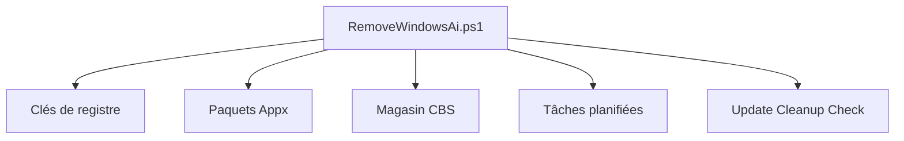

# zoicware/RemoveWindowsAI

> PowerShell script that disables or removes Copilot, Recall and other AI components from Windows 11.

## The problem
Windows 11 adds AI features (Copilot, Recall, assisted typing) that are poorly documented, affect privacy and are hard to remove.

## What it actually does
Modifies registry keys, disables policies, removes AI Appx packages, CBS store packages, scheduled tasks and leftover AI files, and disables Defender's AI and the NPU. A scheduled task redoes the cleanup after updates. Option: reinstall the classic apps (Notepad, Paint, Snipping Tool, Photo Viewer).

## How it is wired

Diagram inferred from the README; no code diagram provided.

## Trying it
```PowerShell
& ([scriptblock]::Create((irm "https://raw.githubusercontent.com/zoicware/RemoveWindowsAI/main/RemoveWindowsAi.ps1")))
& ([scriptblock]::Create((irm "https://raw.githubusercontent.com/zoicware/RemoveWindowsAI/main/RemoveWindowsAi.ps1"))) -nonInteractive -backupMode -AllOptions
```

## Cost and gotchas
Free. Requires PowerShell 5.1 as administrator (PowerShell 7 not supported). Antivirus software flags it wrongly; the README advises testing in a virtual machine. Backup mode creates a restore point so you can undo.

## What it is not
Not reversible by default: without `-backupMode`, rollback is not guaranteed. Some AI features must be disabled by hand. Windows only.

## Alternatives
No alternative named in the README.

## For you
Worth watching: relevant only if you administer a Windows 11 machine and want to cut the embedded AI; run it in a virtual machine first, as it modifies the system deeply.
