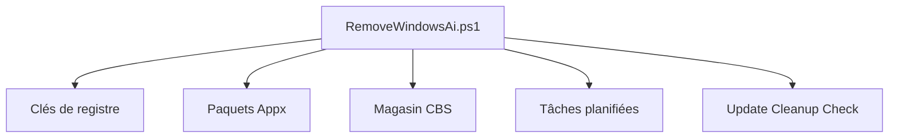

# zoicware/RemoveWindowsAI

> Script PowerShell qui désactive ou supprime Copilot, Recall et autres composants IA de Windows 11.

## Le problème
Windows 11 ajoute des fonctions IA (Copilot, Recall, saisie assistée) peu documentées, qui touchent à la vie privée et sont difficiles à retirer.

## Ce que ça fait vraiment
Modifie des clés de registre, désactive des politiques, supprime les paquets Appx IA, les paquets du magasin CBS, des tâches planifiées, les fichiers IA résiduels, et désactive l'IA de Defender et le NPU. Une tâche planifiée refait le nettoyage après les mises à jour. Option : réinstaller les apps classiques (Notepad, Paint, Outil Capture, Photo Viewer).

## Comment c'est branché

Diagramme déduit du README, aucun diagramme du code fourni.

## Essayer
```PowerShell
& ([scriptblock]::Create((irm "https://raw.githubusercontent.com/zoicware/RemoveWindowsAI/main/RemoveWindowsAi.ps1")))
& ([scriptblock]::Create((irm "https://raw.githubusercontent.com/zoicware/RemoveWindowsAI/main/RemoveWindowsAi.ps1"))) -nonInteractive -backupMode -AllOptions
```

## Coût et pièges
Gratuit. Exige PowerShell 5.1 en administrateur (PowerShell 7 non supporté). Les antivirus le signalent à tort ; le README conseille de tester en machine virtuelle. Le mode sauvegarde crée un point de restauration pour pouvoir annuler.

## Ce que ce n'est pas
Pas un outil réversible par défaut : sans `-backupMode`, le retour arrière n'est pas garanti. Certaines fonctions IA doivent se désactiver à la main. Windows uniquement.

## Alternatives
Aucune alternative nommée dans le README.

## Pour toi
À surveiller : pertinent seulement si tu administres un poste Windows 11 et veux couper l'IA embarquée ; exécute-le d'abord en machine virtuelle, car il modifie le système en profondeur.

