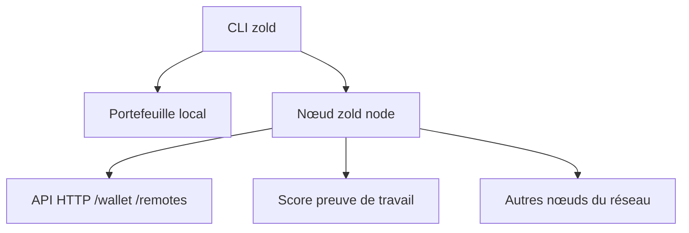

# zold-io/zold

> Blockchain-free cryptocurrency written in Ruby, with a command-line wallet and node.

## The problem
Blockchain cryptocurrencies are slow and costly: Zold proposes to do without them, with no global ledger.

## What it actually does
Provides the `zold` command to create a wallet, push it, pay, fetch wallets and run a node (proof of work, HTTP API). A Ruby SDK mirrors the same commands. The node collects taxes and bonuses in ZLD for its online presence.

## How it is wired

Simplified diagram based on the sheet, no diagram provided.

## Trying it
```bash
zold --help
ssh-keygen -t rsa -b 4096
zold create
zold push 5f96e731e48ae21f
zold node --invoice=5f96e731e48ae21f
bundle update
bundle exec rake
```

## Cost and gotchas
Free, but a node consumes CPU and disk, and updates itself. The RSA private key in `~/.ssh` controls the wallet: back it up. Commands target a test network by default.

## What it is not
Not a proven "anonymous" currency: these claims come from the README alone. Not a data tool. The README promises earnings in ZLD without stating their value.

## Alternatives
None named in the README (Bitcoin serves as a point of comparison).

## For you
Technical curiosity unrelated to data, AI or MLOps, and speculative in nature: ignore.
