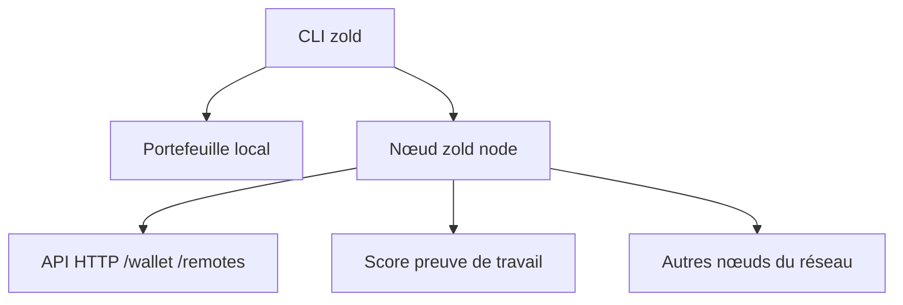

# zold-io/zold

> Crypto-monnaie sans chaîne de blocs, écrite en Ruby, avec portefeuille en ligne de commande et nœud.

## Le problème
Les crypto-monnaies à chaîne de blocs sont lentes et coûteuses : Zold propose de s'en passer, sans registre général.

## Ce que ça fait vraiment
Fournit la commande `zold` pour créer un portefeuille, le pousser, payer, récupérer des portefeuilles et faire tourner un nœud (preuve de travail, API HTTP). Un SDK Ruby reprend les mêmes commandes. Le nœud récupère des taxes et des primes en ZLD pour sa présence en ligne.

## Comment c'est branché

Schéma simplifié d'après la fiche, sans diagramme fourni.

## Essayer
```bash
zold --help
ssh-keygen -t rsa -b 4096
zold create
zold push 5f96e731e48ae21f
zold node --invoice=5f96e731e48ae21f
bundle update
bundle exec rake
```

## Coût et pièges
Gratuit, mais un nœud consomme processeur et disque, et se met à jour tout seul. La clé privée RSA dans `~/.ssh` contrôle le portefeuille : à sauvegarder. Les commandes visent par défaut un réseau de test.

## Ce que ce n'est pas
Pas une monnaie « anonyme » prouvée : ces affirmations viennent du README seul. Pas un outil de données. Le README promet des gains en ZLD sans en dire la valeur.

## Alternatives
Aucune nommée dans le README (Bitcoin sert de point de comparaison).

## Pour toi
Curiosité technique sans lien avec data, IA ou MLOps, et nature spéculative : à ignorer.

