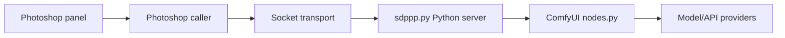

# zombieyang/sd-ppp

> Unofficial Photoshop plugin that connects the application to ComfyUI and to image model APIs.

## The problem
Using generative models from Photoshop requires manual back-and-forth of exports and imports.

## What it actually does
Very short README. Version 2.0 beta (Photoshop 2025, PS26+) supports models and apps from replicate.com and runninghub.ai, without ComfyUI custom nodes. Redesigned interface to send and receive images, keyboard shortcuts, selection of areas, layers or documents. According to the code: a Photoshop panel, a ComfyUI extension and a Python server communicating over sockets.

## How it is wired

## Trying it
No command documented in the README; the 2.0 Beta download and the official site are given as links.

## Cost and gotchas
Photoshop 2025 required for 2.0. Third-party APIs (Replicate, RunningHub, etc.) are billed separately.

## What it is not
Not an Adobe product. Detailed commands and usage are on the website, not in the repository.

## Alternatives
No alternative named in the README.

## For you
Worth watching: only if your flows go through Photoshop and ComfyUI; of little interest for data or MLOps.
