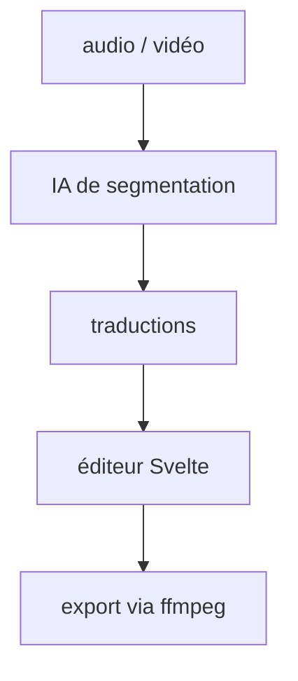

# zonetecde/QuranCaption

> Desktop video editor that automatically subtitles Quran recitations, with translations.

## The problem
Manually syncing subtitles and translations verse by verse for a recitation is time-consuming.

## What it actually does
Drop in an audio or video file: the AI segments it verse by verse (cuts, silences, basmala, isti'adha), aligns the translations (over 100 in more than 40 languages), then lets you customize font, colors and calligraphy and export for YouTube, TikTok or Instagram. Cloud or local processing.

## How it is wired
Simplified diagram based on the sheet, no diagram provided.

## Trying it
No documented command: Windows, macOS and Linux installers. To develop, add `ffmpeg`, `ffprobe` and `yt-dlp` to `src-tauri/binaries/`.

## Cost and gotchas
Svelte, TypeScript, Rust, Tauri, Python stack. The cloud option relies on an unspecified third-party service. License present but unidentified.

## What it is not
Not a general transcription tool: it targets the Quranic text. Not a general-purpose video editor.

## Alternatives
No alternative named in the README.

## For you
Ignore: niche domain application, interesting only as an example of an audio-to-subtitles pipeline.
