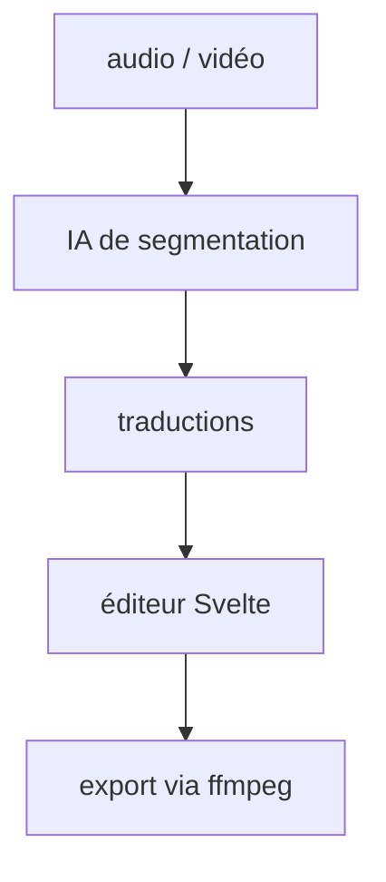

# zonetecde/QuranCaption

> Éditeur vidéo de bureau qui sous-titre automatiquement des récitations coraniques, avec traductions.

## Le problème
Synchroniser à la main verset par verset les sous-titres et traductions d'une récitation est long.

## Ce que ça fait vraiment
Dépose un audio ou une vidéo : l'IA segmente verset par verset (coupures, silences, basmala, istiʿādha), aligne les traductions (plus de 100 dans plus de 40 langues), puis personnalise police, couleurs, calligraphie et exporte pour YouTube, TikTok ou Instagram. Traitement cloud ou local.

## Comment c'est branché
Schéma simplifié d'après la fiche, sans diagramme fourni.

## Essayer
Aucune commande documentée : installeurs Windows, macOS et Linux. Pour développer, ajouter `ffmpeg`, `ffprobe` et `yt-dlp` dans `src-tauri/binaries/`.

## Coût et pièges
Pile Svelte, TypeScript, Rust, Tauri, Python. L'option cloud suppose un service tiers non détaillé. Licence présente mais non identifiée.

## Ce que ce n'est pas
Pas un outil de transcription général : il cible le texte coranique. Pas un éditeur vidéo généraliste.

## Alternatives
Aucune alternative nommée dans le README.

## Pour toi
Ignorer : application métier de niche, intéressante seulement comme exemple de pipeline audio vers sous-titres.

