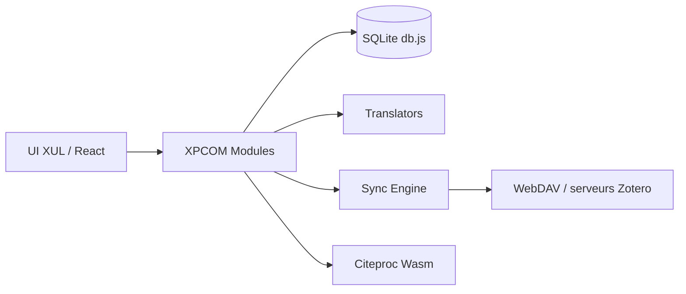

# zotero/zotero

> Reference manager for collecting, organizing, citing and sharing research sources.

## The problem
The README is truncated: the problem is not developed. Based on the introductory sentence, managing research sources and citations.

## What it actually does
The README gives no detail. Based on the architecture drawn from the code: cross-platform desktop application on a Mozilla base (XUL, XPCOM, React), SQLite storage, a sync engine (Zotero server, WebDAV), translators to extract references from the web, bibliography formatting by a citeproc engine in Wasm, and packages for macOS, Windows and Linux.

## How it is wired

## Trying it
No command in the README: pointer to the Zotero documentation.

## Cost and gotchas
License present but not identified by GitHub: to be checked. 1,599 open issues; the README points to the forums rather than the issues.

## What it is not
This repository is not a user guide: it is the application's source code. The conditions of synchronization (account, quotas) are not described.

## Alternatives
No alternative named in the README.

## For you
Worth watching: useful for managing a bibliography for AI watch and research; too little material to go further on this repository.
