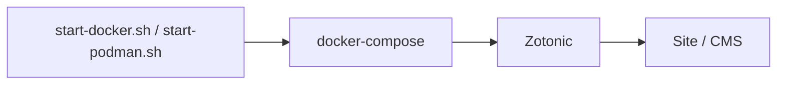

# zotonic/zotonic

> Real-time Erlang web framework and CMS for dynamic sites and distributed applications.

## The problem
Building interactive, real-time sites with a content back office without assembling a framework and a CMS yourself.

## What it actually does
The README is short: an Erlang framework and content management system, advertised as fast and stable. Installation by download, or through Docker and Podman images. The launchers `start-docker.sh` and `start-podman.sh` use the local UID and GID. The rest points to the documentation.

## How it is wired

Diagram limited to what the README says.

## Trying it
```bash
./start-docker.sh
ZOTONIC_UID=1001 ZOTONIC_GID=1001 ./start-docker.sh
./start-podman.sh
```

## Cost and gotchas
Free. The launchers must be started as a normal user; the UID and GID must be non-zero.

## What it is not
Not a data tool: it is a web CMS and an Erlang framework, unrelated to data or AI.

## Alternatives
The README names no alternative.

## For you
Ignore: Erlang CMS, outside the data/AI/MLOps profile.
