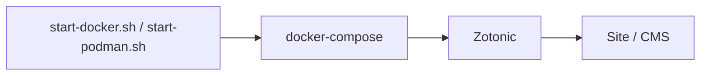

# zotonic/zotonic

> Framework web et CMS Erlang temps réel pour sites dynamiques et applications distribuées.

## Le problème
Construire des sites interactifs et temps réel avec un back-office de contenu sans assembler soi-même framework et CMS.

## Ce que ça fait vraiment
Le README est court : framework et système de gestion de contenu en Erlang, annoncé rapide et stable. Installation par téléchargement, ou par images Docker et Podman. Les lanceurs `start-docker.sh` et `start-podman.sh` utilisent l'UID et le GID locaux. Le reste renvoie à la documentation.

## Comment c'est branché

Schéma limité à ce que dit le README.

## Essayer
```bash
./start-docker.sh
ZOTONIC_UID=1001 ZOTONIC_GID=1001 ./start-docker.sh
./start-podman.sh
```

## Coût et pièges
Gratuit. Les lanceurs se démarrent en utilisateur normal ; UID doivent être non nuls.

## Ce que ce n'est pas
Pas un outil data : c'est un CMS web et un framework en Erlang, sans lien avec la data ou l'IA.

## Alternatives
Le README ne nomme pas d'alternative.

## Pour toi
À ignorer : CMS Erlang, hors profil data/IA/MLOps.

