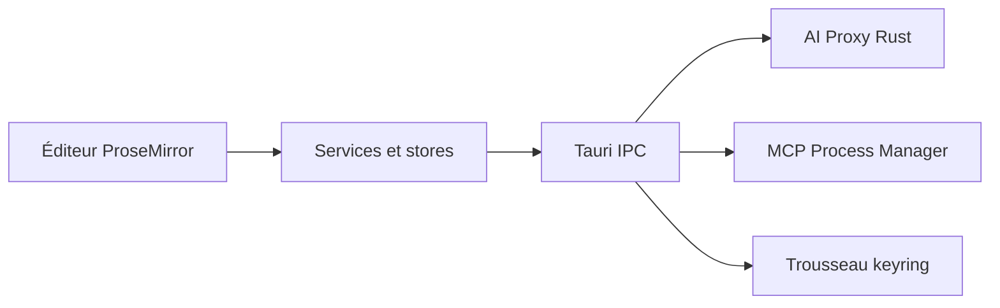

# zouwei/moraya

> Lightweight Markdown and Typst editor with multi-provider AI chat and MCP servers, for writers.

## The problem
Writing in Markdown with the help of an LLM forces you to juggle between an editor, a chat window and publishing tools.

## What it actually does
Tauri v2 desktop application (Rust, Svelte 5, ProseMirror) of about 10 MB. Visual, source or split editing, KaTeX and Mermaid rendering, HTML, PDF and LaTeX export. AI chat to Claude, OpenAI, Gemini, Ollama and others, MCP servers, voice transcription, publishing to GitHub and image hosting. Keys are stored in the system keychain and calls go through the Rust backend.

## How it is wired


## Trying it
```bash
brew tap zouwei/moraya
brew install --cask moraya

pnpm install
pnpm tauri dev
```

## Cost and gotchas
The application is free but each AI, voice or image provider requires your own key and its billing. Building requires Rust, Node 18 or later and pnpm 10. Typst is downloaded on demand.

## What it is not
Not an AI model or service: you bring the keys. Not a data tool: it is a text editor. A web version (web.moraya.app) exists in addition to the desktop one, with cloud storage at your expense.

## Alternatives
No alternative named in the README.

## For you
Keep an eye on it: a local Markdown editor with MCP and Ollama can be used to write documentation, but it relies on a single author and the README piles on superlatives.
