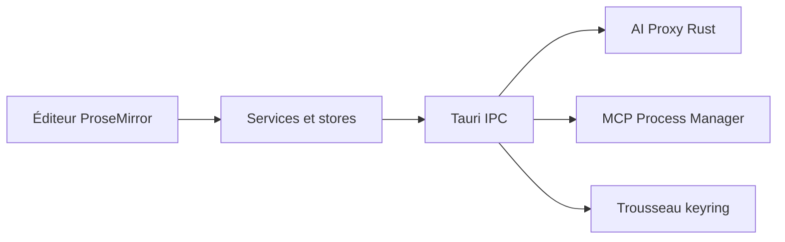

# zouwei/moraya

> Éditeur Markdown et Typst léger, avec chat IA multi-fournisseurs et serveurs MCP, pour rédacteurs.

## Le problème
Écrire en Markdown avec l'aide d'un LLM oblige à jongler entre un éditeur, une fenêtre de chat et des outils de publication.

## Ce que ça fait vraiment
Application de bureau Tauri v2 (Rust, Svelte 5, ProseMirror) d'environ 10 Mo. Édition visuelle, source ou partagée, rendu KaTeX et Mermaid, export HTML, PDF et LaTeX. Chat IA vers Claude, OpenAI, Gemini, Ollama et d'autres, serveurs MCP, transcription vocale, publication vers GitHub et hébergement d'images. Les clés sont dans le trousseau du système et les appels passent par le backend Rust.

## Comment c'est branché


## Essayer
```bash
brew tap zouwei/moraya
brew install --cask moraya

pnpm install
pnpm tauri dev
```

## Coût et pièges
L'application est gratuite mais chaque fournisseur d'IA, de voix ou d'image demande ta propre clé et sa facturation. Compiler demande Rust, Node 18 ou plus et pnpm 10. Typst est téléchargé à la demande.

## Ce que ce n'est pas
Pas un modèle ni un service d'IA : tu apportes les clés. Pas un outil data : c'est un éditeur de texte. Une version web (web.moraya.app) existe en plus du bureau, avec stockage cloud à ta charge.

## Alternatives
Aucune alternative nommée dans le README.

## Pour toi
À surveiller : un éditeur Markdown local avec MCP et Ollama peut servir à rédiger de la documentation, mais il repose sur un seul auteur et le README multiplie les superlatifs.

