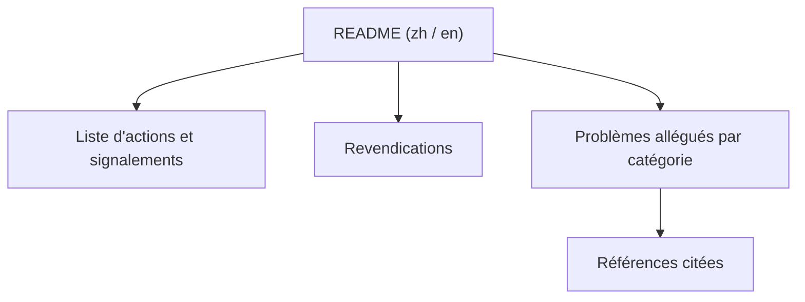

# zouzhekang/YJYpaper

> Document qui recense des erreurs reprochées à une thèse de master, à l'appui d'une campagne de signalement.

## Le problème
Le dépôt cherche à rassembler en un lieu des griefs contre un mémoire universitaire précis et contre sa titulaire.

## Ce que ça fait vraiment
Un long README en chinois, doublé d'une version anglaise, liste des fautes alléguées : données jugées fabriquées, passages jugés plagiés, erreurs de calcul, de modèle statistique et de rédaction, citations douteuses. Il énonce des revendications (retrait du diplôme) et recense des signalements adressés à des autorités. Le contenu relève de l'accusation, non vérifiée ici.

## Comment c'est branché
Schéma simplifié d'après la fiche, sans diagramme fourni.

## Essayer
Aucune commande n'existe : c'est un document à lire. Le README mentionne un tutoriel de conversion en PDF.

## Coût et pièges
Gratuit. Le dépôt vise une personne privée nommée et mêle faits allégués et appels à la sanction ; le README ne fournit pas de preuves vérifiables dans le texte lu.

## Ce que ce n'est pas
Ce n'est ni un outil, ni une analyse de recherche, ni une source neutre : c'est un dossier militant. Le texte lu était tronqué dans la partie anglaise.

## Alternatives
- Aucune alternative nommée dans le README.

## Pour toi
À ignorer : aucun contenu technique réutilisable, et une campagne dirigée contre une personne n'a pas sa place dans une veille data, IA ou MLOps.

