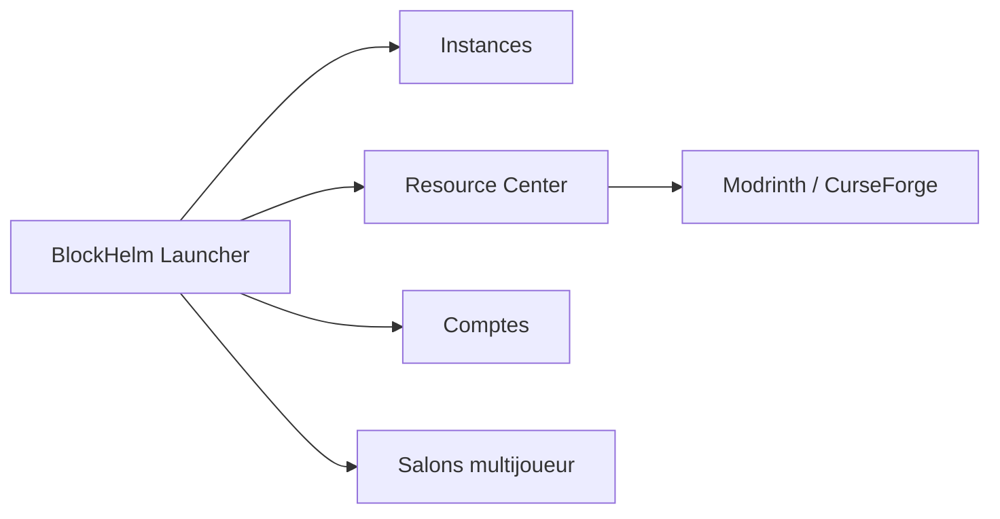

# zqq-699/BlockHelm-Launcher

> Minecraft Java launcher for Windows: instances, mods, accounts and multiplayer, for players.

## The problem
Managing several Minecraft Java versions, mods and accounts by hand is a pain.

## What it actually does
Installs vanilla Minecraft with Fabric, Forge, NeoForge or Quilt, manages independent instances, installs mods and modpacks via Modrinth and CurseForge, manages accounts (Microsoft, offline, third-party) and creates multiplayer rooms by code. The README is in Chinese and English.

## How it is wired
Simplified diagram based on the sheet, no diagram provided.

## Trying it
No documented command: the README describes the application and its prerequisites (Windows 10 or 11, .NET 8 Desktop Runtime).

## Cost and gotchas
Free. Windows only, with .NET 8. The author recommends a legitimate copy of Minecraft.

## What it is not
It is not an official Minecraft product. It has nothing to do with data or AI.

## Alternatives
No alternative named in the README.

## For you
Ignore: a game launcher unrelated to data, AI or MLOps.
