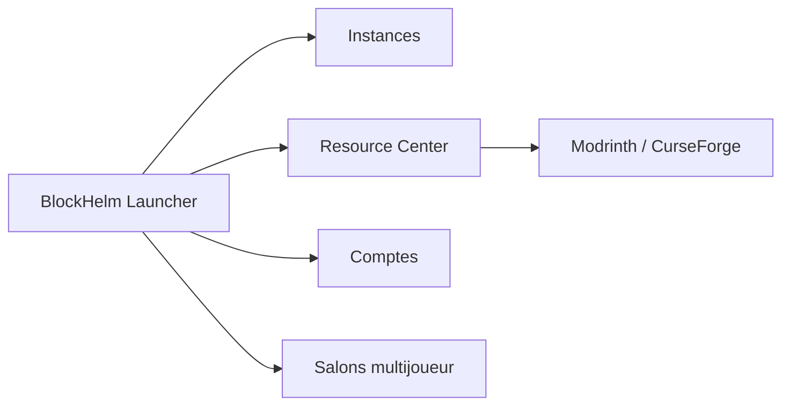

# zqq-699/BlockHelm-Launcher

> Lanceur Minecraft Java pour Windows : instances, mods, comptes et multijoueur, pour joueurs.

## Le problème
Gérer plusieurs versions, mods et comptes de Minecraft Java à la main est pénible.

## Ce que ça fait vraiment
Installe Minecraft vanilla avec Fabric, Forge, NeoForge ou Quilt, gère des instances indépendantes, installe mods et modpacks via Modrinth et CurseForge, gère comptes (Microsoft, hors ligne, tiers) et crée des salons multijoueurs par code. Le README est en chinois et en anglais.

## Comment c'est branché
Schéma simplifié d'après la fiche, sans diagramme fourni.

## Essayer
Aucune commande documentée : le README décrit l'application et ses prérequis (Windows 10 ou 11, .NET 8 Desktop Runtime).

## Coût et pièges
Gratuit. Windows uniquement, avec .NET 8. Une copie légitime de Minecraft est recommandée par l'auteur.

## Ce que ce n'est pas
Ce n'est pas un produit officiel Minecraft. Il ne concerne ni data ni IA.

## Alternatives
Aucune alternative nommée dans le README.

## Pour toi
À ignorer : lanceur de jeu sans rapport avec data, IA ou MLOps.

