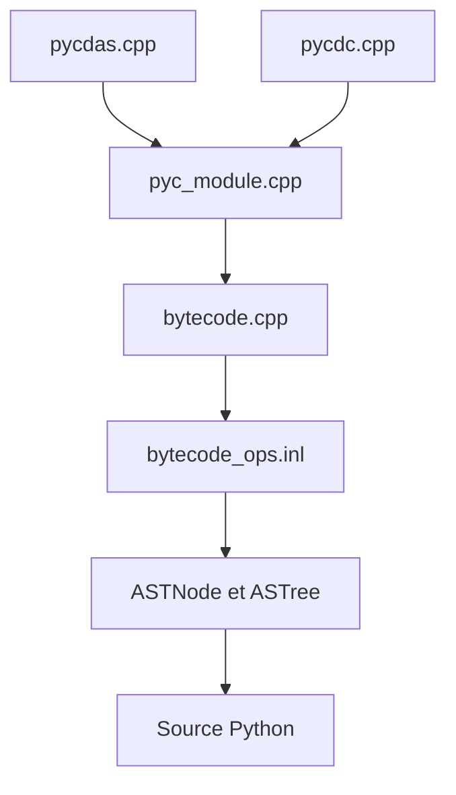

# zrax/pycdc

> C++ disassembler and decompiler that rebuilds Python code from `.pyc` bytecode.

## The problem
Recovering the source of a compiled Python file when the original is lost, for a variety of Python versions.

## What it actually does
Two tools: `pycdas` prints the disassembly, `pycdc` prints the decompiled Python to standard output. They read `.pyc` files or objects serialized by `marshal` (version to be specified). The project aims at all Python versions through opcode tables in `bytes/`. According to the architecture, a loader reads the file, the disassembler produces tokens, then a syntax tree is used to write the code.

## How it is wired


## Trying it
```bash
./pycdas [PATH TO PYC FILE]
./pycdc [PATH TO PYC FILE]
make check JOBS=4
```

## Cost and gotchas
Free. Built with CMake. Decompilation remains partial: errors are written to standard error.

## What it is not
Not a guarantee of identical source: the result is a reconstruction. Respect the law on decompiled code.

## Alternatives
No alternative named in the README.

## For you
Worth watching: handy for recovering a lost Python script, but keep it for exceptional cases.
