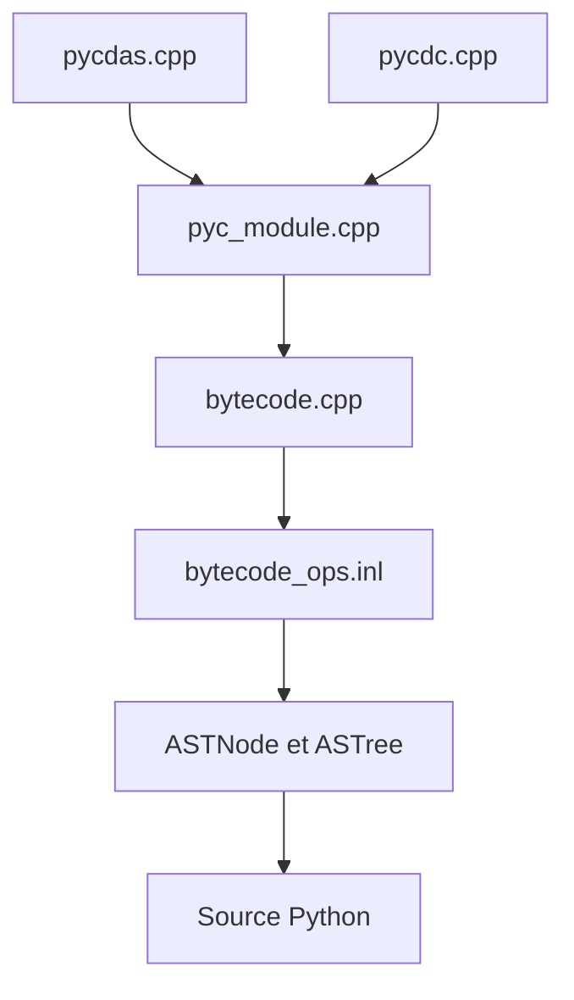

# zrax/pycdc

> Désassembleur et décompilateur C++ qui reconstruit du code Python à partir de bytecode `.pyc`.

## Le problème
Retrouver le source d'un fichier Python compilé quand l'original est perdu, pour des versions variées de Python.

## Ce que ça fait vraiment
Deux outils : `pycdas` affiche le désassemblage, `pycdc` imprime le Python décompilé sur la sortie standard. Ils lisent des `.pyc` ou des objets sérialisés par `marshal` (version à préciser). Le projet vise tous les versions de Python via des tables d'opcodes dans `bytes/`. D'après l'architecture, un chargeur lit le fichier, le désassembleur produit des jetons, puis un arbre syntaxique sert à écrire le code.

## Comment c'est branché


## Essayer
```bash
./pycdas [PATH TO PYC FILE]
./pycdc [PATH TO PYC FILE]
make check JOBS=4
```

## Coût et pièges
Gratuit. Compilation avec CMake. La décompilation reste partielle : des erreurs sont écrites sur la sortie d'erreur.

## Ce que ce n'est pas
Pas une garantie de source identique : le résultat est une reconstruction. Respecter le droit sur le code décompilé.

## Alternatives
Aucune alternative nommée dans le README.

## Pour toi
Surveiller : pratique pour récupérer un script Python perdu, mais à garder pour les cas exceptionnels.

