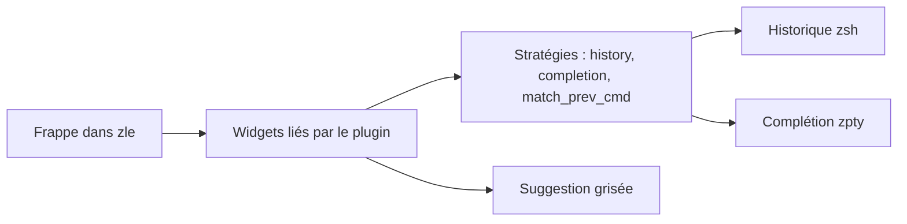

# zsh-users/zsh-autosuggestions

> zsh plugin that suggests commands in gray as you type, based on history and completion.

## The problem
Retyping long commands you have already used wastes time in the terminal.

## What it actually does
Displays after the cursor a suggestion drawn from history, completion or the previous command (strategies history, completion, match_prev_cmd). The right arrow or End accepts it, forward-word accepts it partially. Suggestions are fetched asynchronously since zsh 5.0.8. Settings through `ZSH_AUTOSUGGEST_*` variables.

## How it is wired

Simplified diagram based on the sheet, no diagram provided.

## Trying it
```bash
ZSH_AUTOSUGGEST_STRATEGY=(history completion)
ZSH_AUTOSUGGEST_BUFFER_MAX_SIZE=20
bindkey '^ ' autosuggest-accept
```

## Cost and gotchas
Free. Requires zsh 4.3.11 or later. The last push dates from June 2025. Conflicts with other plugins are possible, hence the instruction to reduce your config before reporting a bug.

## What it is not
Not AI: no model, only history and completion. Not a shell replacement. The installation steps are in INSTALL.md, absent from the README provided.

## Alternatives
No alternative named in the README.

## For you
Adopt: you spend your day in the terminal, the gain is immediate and the cost zero, despite a repository that has been inactive for a year.
